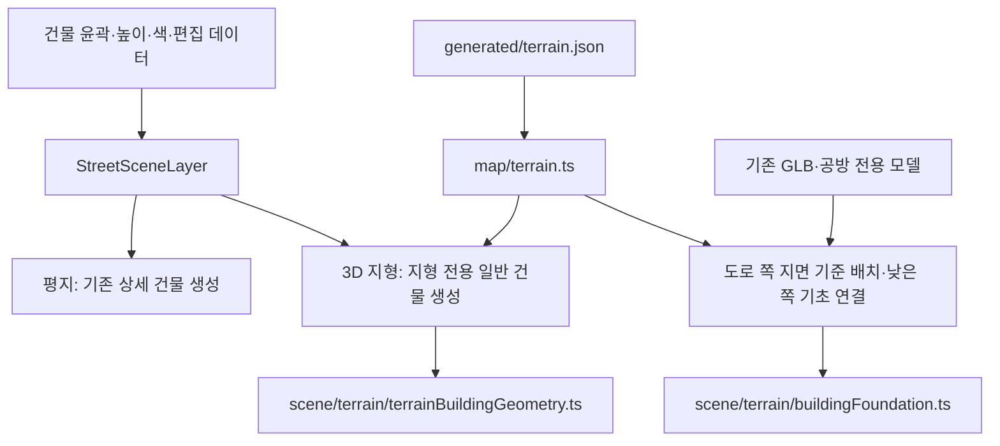

# 감천 골목지도 — 파일 구조와 정리 기준

정리일: 2026-10-12. 대상은 이 문서가 들어 있는 `art-map` 원본 프로젝트입니다.

## 1. 작업 폴더의 범위

현재 작업 공간에는 역할이 다른 두 묶음이 있습니다.

```text
실서버_배포본_20261001/
├─ README.md                     실서버 배포본 안내
├─ deployment.json               당시 배포 버전·연결 리소스 기록
├─ wrangler.jsonc                Worker 배포 설정
├─ static-assets-manifest.json   당시 공개 파일 목록·검증 기록
├─ worker/                       내려받은 Worker 배포 모듈
├─ static/                       내려받은 홈페이지 공개 파일
├─ *.jpg                         로컬 작업 중 저장한 화면 기록
└─ art-map/                      현재 수정하는 지도 원본 프로젝트
```

`worker/`와 `static/`는 과거 배포 결과를 복원하기 위한 자료이고, `art-map/`은 지도 기능을 개발하는 원본입니다. `art-map/`에는 지도 앱의 관리자 로그인·API가 들어 있습니다. 홈페이지 전체 서버 코드는 별도입니다. 배포본의 D1 데이터, R2 객체, Secret 값도 이 폴더에 복사된 상태가 아닙니다.

## 2. 정리 기준

| 기준 | 적용 방법 | 이유 |
|---|---|---|
| 기능별 분류 | 지도, 장소, 길찾기, 골목길, 건물 편집을 각각의 `src/` 하위 폴더에 둡니다. | 수정할 기능의 위치를 쉽게 찾습니다. |
| 지형 표현 분류 | 지형 전용 건물·기초 계산은 `src/scene/terrain/`에 둡니다. | 평지 표현과 경사면 계산의 책임을 구분합니다. |
| 실행 화면 분류 | 공개 진입점은 `index.html`, 편집 진입점은 `studio/index.html`, 단독 모델 확인 화면은 `previews/`에 둡니다. | 실제 지도 진입점과 시안 확인 화면을 구분합니다. |
| 데이터와 계산 결과 분류 | 입력 자료는 `src/data/`, 미리 계산한 결과는 `src/generated/`에 둡니다. | 원본 수정과 재생성 작업을 구분합니다. |
| 모델과 제작 도구 분류 | GLB 파일은 `src/assets/models/`, 제작·변환 도구는 `scripts/`에 둡니다. | 모델 결과물과 모델을 만드는 코드를 구분합니다. |
| 설명과 조사 자료 분류 | 관리 설명은 `docs/`, 사진·도면·관찰 근거와 조사 보고서는 `design/`에 둡니다. | 운영 설명과 모델링 근거를 쉽게 찾습니다. |
| 검사 위치 | `*.test.ts`·`*.test.tsx`는 검사 대상 코드 옆에 둡니다. | 파일을 옮길 때 관련 검사도 함께 관리합니다. |
| 생성 폴더 관리 | `node_modules/`, `dist/`, `dist-app/`, `.wrangler/`는 설치·빌드가 만드는 폴더로 취급합니다. | 이 폴더를 직접 수정해도 다음 생성 시 덮어쓰입니다. |

기존 기능 폴더는 유지하고, 역할이 명확한 지형 파일과 단독 미리보기만 이동했습니다. 큰 렌더러를 여러 파일로 분해하거나 저장 데이터 형식을 바꾸는 작업은 이번 파일 정리에 포함하지 않았습니다.

## 3. 정리 후 프로젝트 구조

```text
art-map/
├─ README.md                     시작 안내·문서 연결
├─ NOTICE.md                     라이선스·데이터 출처
├─ package.json                  의존성·실행 명령
├─ package-lock.json             설치 버전 기록
├─ index.html                    공개 지도 진입점
├─ studio/index.html             관리자 편집 앱 진입점
├─ server/                       지도 API(홈페이지 서버 안에서 돎, export:site로 넣음)
├─ migrations/                   D1 테이블 정의
├─ vite.config.ts                로컬 개발·일반 빌드 설정
├─ vite.lib.config.ts            React 라이브러리 빌드 설정
├─ tsconfig.json                 TypeScript 검사 설정
├─ tsconfig.lib.json             라이브러리 타입 선언 생성 설정
├─ .gitignore                    Git 제외 기준
├─ .claude/launch.json            개발 도구 실행 설정
├─ docs/
│  ├─ PROJECT_STRUCTURE.md       이 문서: 구조·분류 기준·이동 내역
│  ├─ MAINTENANCE_GUIDE.md       수정·실행·홈페이지 반영 설명
│  ├─ LOCAL_EDITOR_GUIDE.md      로컬 편집·백업·서버 공개 사용 방법
│  └─ FEATURE_INTEGRATION.md     최신 커밋 통합과 기능 결정
├─ previews/
│  ├─ greenhouse-preview.html
│  └─ beautiful-hangul-preview.html
├─ design/                       도면·OSM 조사 원문·외관 조사·시안 근거
├─ scripts/                      데이터 수집·사전 계산·모델 제작·내보내기
└─ src/
   ├─ index.ts                   외부에 제공하는 컴포넌트·타입 진입점
   ├─ types.ts                   장소 등 공통 타입
   ├─ GamcheonMap.tsx            지도와 기능 패널 연결
   ├─ gamcheon-map.css           지도 공통 스타일
   ├─ studio.tsx / studio.css    편집 앱·로그인 화면
   ├─ embed.tsx / embed.css      홈페이지 iframe 지도 화면
   ├─ map/                      지도 설정·좌표·지형 높이·GPS·모바일 UI
   ├─ places/                   장소 목록·검색·작가님 공방 정보
   ├─ route/                    경로 계산·길찾기 패널
   ├─ alleys/                   골목 편집·GPS 기록·GPX·저장 연결
   ├─ buildings/                건물 편집·배치·고도 설정·실행 취소·ZIP·초안/공개 저장·GLB 목록
   ├─ scene/
   │  ├─ StreetSceneLayer.ts     평지/지형 분기와 Three.js 장면 조립
   │  ├─ streetSceneData.ts      건물 데이터·윤곽·외관 규칙
   │  ├─ groundGeometry.ts      바닥 도형·지형에 도형 얹기
   │  ├─ planGeometry.ts        윤곽의 넓이·방향·거리 계산
   │  ├─ streetRoofGeometry.ts  지붕 계산
   │  ├─ streetTextures.ts      벽·창·바닥 질감
   │  ├─ threeShadows.ts        조명·그림자
   │  ├─ modelFiles.ts          GLB 주소·다운로드·로딩
   │  ├─ placedModels.ts        사용자 GLB 배치·크기·방향
   │  ├─ buildingPicking.ts     병합된 3D 도형 클릭을 건물 ID로 연결
   │  ├─ artistWorkshopModel.ts 작가님 공방 전용 표현
   │  ├─ beautifulHangul.ts     아름다운한글 위치·방향
   │  ├─ landmarkBuildings.ts   전용 건물 식별
   │  ├─ terrain/
   │  │  ├─ terrainBuildingGeometry.ts       지형 기준 층·벽 밑단 계산
   │  │  ├─ terrainBuildingGeometry.test.ts
   │  │  ├─ buildingFoundation.ts           지형 기초·높이 계산
   │  │  └─ buildingFoundation.test.ts
   │  └─ 기타 도로·골목·경로·가림 계산 및 관련 검사
   ├─ data/                     OSM·경계·지도 스타일·기록 골목 입력 자료
   ├─ generated/                terrain·road-ground·building-outlines 계산 결과
   └─ assets/models/custom/     직접 제작한 GLB 파일
```

이 트리는 역할을 설명하기 위해 주요 파일을 표시한 것입니다. 개별 검사 파일과 보조 파일을 모두 나열한 목록은 아닙니다.

## 4. 실제 이동 내역

| 이전 위치 | 정리 후 위치 |
|---|---|
| `src/scene/buildingFoundation.ts` | `src/scene/terrain/buildingFoundation.ts` |
| `src/scene/buildingFoundation.test.ts` | `src/scene/terrain/buildingFoundation.test.ts` |
| `src/scene/terrainBuildingGeometry.ts` | `src/scene/terrain/terrainBuildingGeometry.ts` |
| `src/scene/terrainBuildingGeometry.test.ts` | `src/scene/terrain/terrainBuildingGeometry.test.ts` |
| `greenhouse-preview.html` | `previews/greenhouse-preview.html` |
| `beautiful-hangul-preview.html` | `previews/beautiful-hangul-preview.html` |

관련 import와 아름다운한글 시안 문서의 미리보기 경로를 함께 수정했습니다. 최신 구조의 공개 지도는 `/`, 편집기는 `/studio/`입니다. 단독 모델 미리보기의 새 주소는 [관리 설명서](MAINTENANCE_GUIDE.md)에 있습니다.

## 5. 평지와 3D 지형의 관계



평지와 3D는 **생성하는 도형이 다릅니다.** 건물의 위치·색·높이와 관리자 편집 데이터는 현재 공유합니다. 따라서 별도 건물 데이터베이스나 별도 편집 저장소가 생긴 것은 아닙니다.

현재 3D 일반 건물은 도로에 가까운 면의 지면 높이를 기준으로 수평 층과 지붕을 잡고, 벽 밑단을 지형에서부터 만듭니다. 땅에 가려질 창은 생략합니다. 이 과정에서 일반 건물의 세부 외관은 시안용으로 단순화했습니다. GLB와 작가님 공방은 기존 모델을 사용하므로, 일반 건물과 같은 방식으로 외관 전체를 새로 생성하지 않습니다.

고도는 8m 격자 지형 데이터의 보간값이며, 건물 도형은 이를 더 촘촘히 샘플링합니다. 샘플링 간격을 줄여도 실측 정밀도가 높아지는 것은 아닙니다. 도로 쪽 출입면 역시 자동 추정이므로 실제 출입구와 다를 수 있습니다.

## 6. 새 파일을 추가할 때

- 화면·상태·저장 기능은 해당 기능 폴더에 둡니다. 예: 건물 편집 기능은 `src/buildings/`.
- 3D 지형 건물의 바닥·벽·기초 계산은 `src/scene/terrain/`에 둡니다.
- 평지와 지형이 함께 쓰는 좌표·지붕·재질·렌더러 도구는 `src/scene/`에 둡니다.
- 조사에서 얻은 지도 자료는 `src/data/`, 조사 설명은 `design/`에 둡니다. 기존 제작 스크립트가 `design/`에 출력하는 조사 보고서도 같은 위치에서 관리합니다.
- 사전 계산 파일은 생성 스크립트를 통해 갱신합니다. `src/generated/`에서 직접 수치만 고치지 않습니다.
- `src/assets/`에는 실제 실행 중 불러오는 파일을 둡니다. 단독 확인 화면은 `previews/`에 둡니다.
- 빌드가 참조하는 `index.html`·`studio/index.html`·`src/index.ts`를 옮길 때는 Vite 설정과 Worker 정적 파일 설정을 함께 수정합니다.

실제 유지보수 순서는 [MAINTENANCE_GUIDE.md](MAINTENANCE_GUIDE.md)를 참고하세요.
